# Lab2：BombLab 实验报告

课程：复旦大学《计算机系统基础》（2026年秋季学期）  
环境：WSL Ubuntu 24.04 / Linux x86_64  
解法：`defuser.c`  
完成范围：正式六关及 Honor

## 1. 实验目标与环境

通过反汇编和 GDB 分析个人二进制炸弹，恢复函数调用、循环、分支、递归、链表和间接调用中的计算关系。解法将任意给定 challenge 转换成口令，不是固定答案表；Honor还使用由前六行口令得到的context以及它自己的challenge。

bomb解析并验证输入，defuser生成满足条件的输入。解法应该格式化输出。

实验初期的终端检查记录如下：

| 项目 | 环境或版本 |
| --- | --- |
| 系统架构 | uname -sm输出Linux x86_64 |
| GCC | 13.3.0 |
| GNU Make | 4.3 |
| Python | 3.12.3 |
| GDB | 15.1 |
| GNU objdump | 2.42 |
| 编译选项 | -std=c11 -O2 -Wall -Wextra -Wpedantic -Werror |

## 2. 分析方法与整数语义

先完成tutor教学，练习“反汇编、断点、观察、恢复公式、换seed验证”。教学关卡seed42的输入为94 289；按公式计算seed43输入86 265，实际运行通过。

正式关卡先分析格式与sscanf，确定整数个数和栈上位置，由这些整数的输入格式为“%u”且每个在栈上占据4 byte，可以判断这里读入的是32位无符号整数，在本实验平台上可用uint32_t表示。备注：%u严格对应的是unsigned int，不能只凭它就断言所有平台上都是uint32_t。再追踪challenge及调用关系。通过每一条均展开地址的形式，跳转表、函数指针表、节点指针均读取实际内容，不按函数名称猜测映射。将比较条件改为生成规则，编译后以公开测试及非公开seed验证。

本文使用AT&T语法，源操作数在前、目的操作数在后。按本实验的调用约定，前六个整数或指针参数依次位于rdi、rsi、rdx、rcx、r8、r9，更多的参数通过栈传递；32位返回值看eax，布尔返回值结合指令看al。每次调用后重新确认寄存器含义。

记C为64位无符号challenge，U32(z)为保留低32位，^为异或。所有32位加减乘按模2^32回绕，右移为无符号逻辑右移。U32(C>>k)与U32(C)>>k不同：前者先进行64位移位再截断。

调试仅观察程序，不修改炸弹内部数据或控制流来绕过校验。set pagination off只改变显示设置。

## 3. 正式六关分析

首先，总结发现，六关里给sscanf传递格式字符串的指令都有类似形式：

```asm
mov    $格式字符串地址,%esi
```

将地址经过`x/s`解析，得到的格式字符串由一个或多个`%u`组成，例如下图。

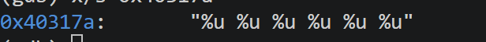

### 3.1 第1关：参数传递与返回值

入口用%u读取一个整数，要求等于p1_compute(challenge)的返回值：

```asm
mov    %r12,%rdi
call   p1_compute
cmp    %eax,-0x14(%rbp)
sete   %al
```

计算函数提取lo=U32(C)、hi=U32(C>>32)、mid=U32(C>>16)。实际调用顺序是step2、step0、step1。关键指令：

```asm
# step2：参数hi、lo
lea    (%rdi,%rdi,2),%eax
add    %esi,%eax
xor    $0x92b9,%eax
# step0：参数lo、mid
xor    $0x7101,%esi
lea    (%rsi,%rdi,8),%eax
# step1：参数t0、t2
lea    0x2554(%rsi),%eax
xor    %edi,%eax
```

恢复关系：

```c
t2 = (3u * hi + lo) ^ 0x92b9u;
t0 = (mid ^ 0x7101u) + 8u * lo;
answer = (t2 + 0x2554u) ^ t0;
```

调用者用ecx暂存t2，rdx、r8保存后续参数。检查具体小函数确认相关寄存器未被改写后，连接计算关系。解法输出一个整数。

### 3.2 第2关：数组与递推

入口用六个%u读取数组a，从rbp-0x40起每4字节一个整数。sscanf中超出寄存器参数范围的输出地址通过栈传递。

```asm
# 首项检查
shr    $0xf,%rax
and    $0x3f,%eax
add    $0x13,%eax
cmp    %eax,%esi
# 循环核心
mov    %r13,%rax
lea    (%rsi,%rsi,4),%esi
shr    %cl,%rax
and    $0x3f,%eax
add    %edx,%eax
xor    %esi,%eax
mov    -0x40(%rbp,%rdx,4),%esi
cmp    %eax,%esi
# 成功后更新
add    $0x1,%rdx
add    $0x3,%ecx
cmp    $0x6,%rdx
jne    循环入口
```

rdx初始为1，是下标i；ecx初始为22，是移位次数。每轮开始时esi保存前一项，先乘5，再参与当前期望值计算。恢复为：

```c
a[0] = U32((C >> 15) & 63u) + 19u;
for (i = 1; i < 6; ++i) {
    shift = 22 + 3 * (i - 1);
    part = U32((C >> shift) & 63u);
    a[i] = (part + i) ^ (5u * a[i - 1]);
}
```

移位次数为22、25、28、31、34，均小于64。访问下标0～5。求解器输出六项，不需要再读入数组后比较。

### 3.3 第3关：switch与跳转表

入口读取两个数，第一个x=U32(C&7)，第二个为p3_dispatch(x,y)，其中y=U32(C>>32)^U32(C>>3)。

```asm
shr    $0x3,%rax
shr    $0x20,%rsi
xor    %eax,%esi
call   p3_dispatch
# disassemble p3_dispatch
mov    %edi,%eax
mov    %esi,%edi
cmp    $0x7,%eax
ja     默认分支
notrack jmp *0x405820(,%rax,8)  # 从表中读取目标地址，再间接跳转
```

用`x/8gx 0x405820`读取实际表项，再追踪跳板。

备注：`8gx`里面，`8`是读取8个单位，`g`是每个单位8 byte，`x`是用十六进制显示。所以总共读取的是8×8=64 byte，不是8×16 byte；每个64位地址虽然常显示成16个十六进制数字，但那是16个数字，不是16个字节。

至于为什么是8个表项，由这两行可以得到：

```asm
cmp    $0x7,%eax
ja     0x4022a5
```

能继续执行查表跳转的索引只有0到7，共8种。前面写入eax还会清零rax的高32位，所以这里可以直接用rax作为索引。

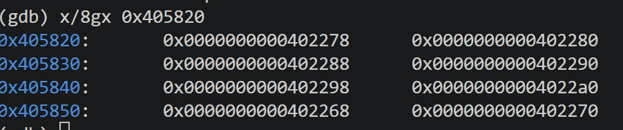

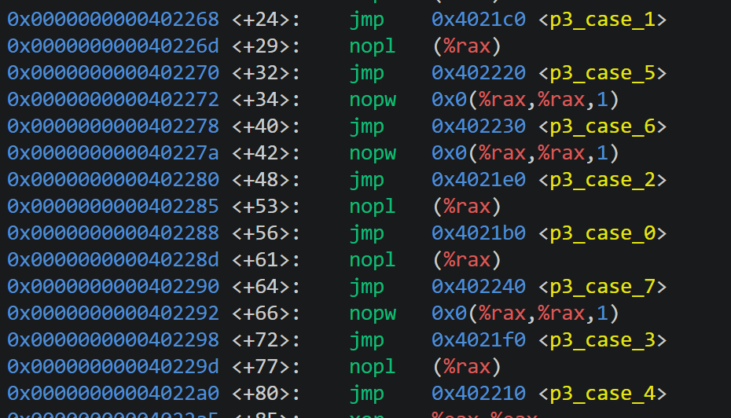

备注：这是编译器实现switch的一种方式；if/else也能表达。

注意坑！该对应内容并不按照顺序或者01234567

| x | 跳板地址 | 实际函数 | 第二个整数 |
| --- | --- | --- | --- |
| 0 | 0x402278 | case_6 | 5*y + 0x20873 |
| 1 | 0x402280 | case_2 | 3*y + 0x119d |
| 2 | 0x402288 | case_0 | 5*y + 0x12ae8 |
| 3 | 0x402290 | case_7 | (y ^ 0x9264) + (y >> 1) |
| 4 | 0x402298 | case_3 | (y ^ 0x1770) + (y >> 2) |
| 5 | 0x4022a0 | case_4 | 5*y + 0x3154 |
| 6 | 0x402268 | case_1 | (4*y) ^ 0xd463 |
| 7 | 0x402270 | case_5 | (2*y) ^ 0xf5b4 |

例如lea 0x20873(%rdi,%rdi,4),%eax表示5*y+0x20873。含右移的函数保留原始y副本，再分别右移、异或并相加。解法按实际表建立switch，输出x和结果，不按函数名顺序猜测分支。
每个函数内部计算不多赘述，该类型计算phase 1、2已经多次练习。

### 3.4 第4关：递归与返回过程

入口读取一个整数，调用walk(x,0,127,salt)：

```c
x = U32(C & 0x7fu);
salt = U32(C >> 7) ^ U32(C >> 32);
```

中点计算：

```asm
mov    %edi,%eax
mov    %edx,%edi
sub    %esi,%edi
shr    $1,%edi
add    %esi,%edi
cmp    %eax,%edi
je     命中分支
```

得到`mid = low + ((high-low) >> 1)`。

命中时跳转到：

```asm
lea    0x3a(%rdi),%eax
xor    %ecx,%eax
ret
```

直接return。翻译成C语言为：

```c
if (x == mid)
    return (mid + 0x3au) ^ salt;
```

未命中时，`lea (%rdi,%rcx,1),%ebx`保存本层`mid+salt`。`cmp %edi,%eax`之后的`jb`表示无符号`x<mid`。此时跳转：

```asm
lea    -0x1(%rdi),%edx
mov    %eax,%edi
call   0x402330 <p4_walk>
lea    (%rax,%rax,2),%eax
xor    %ebx,%eax
mov    -0x8(%rbp),%rbx
leave
xor    $0x1f,%eax
ret
```

可翻译为C语言：

```c
if (x < mid)
    return (3u * walk(x, low, mid-1, salt))
           ^ (mid + salt) ^ 0x1fu;
```

若前面的相等、小于都没有命中，即`x>mid`，则继续执行右分支：

```asm
lea    0x1(%rdi),%esi
mov    %eax,%edi
call   0x402330 <p4_walk>
lea    (%rax,%rax,2),%eax
xor    %ebx,%eax
mov    -0x8(%rbp),%rbx
leave
xor    $0x14,%eax
ret
```

可以翻译为：

```c
return (3u * walk(x, mid+1, high, salt))
       ^ (mid + salt) ^ 0x14u;
```

备注：`leave`负责恢复栈帧，不等于`ret`。它之后的异或仍然要执行，不能漏掉！！。

此时除去nopw等用于：填充、对齐而不参与口令计算的指令，主要计算路径就已经读完。所以不用在乎。

汇编保存、恢复rbx以保留各层数据，C用局部变量表达同样效果。答案不是二分查找的位置，而是命中后逐层运算的返回值。x属于[0,127]，每次保留含x的区间，最终命中；x为0或127也不会执行无效区间更新。

### 3.5 第5关：结构体与链表

入口读取两个数，调用p5_traverse(challenge,&tag)，

备注：我认为本关难点在于判断出这是一个链表。以及关于调用时调用的到底时地址还是地址储存的内存等基本功。以下为判断方法：

```asm
mov 0x405b60(,%rax,8),%rdx
```

根据phase 3的跳转表经验，已然发现它长得很像：rdx = table[index];
并且由之前 rax=challenge&7。可以判断出索引有0～7共8种，对应表里的8个入口；表项里储存的是节点地址，不是下标。但具体内容我们不确定，依然需要解析。

```text
(gdb) x/8gx 0x405b60
0x405b60 <p5_heads>:    0x0000000000405be0      0x0000000000405bb0
0x405b70 <p5_heads+16>: 0x0000000000405c00      0x0000000000405c40
0x405b80 <p5_heads+32>: 0x0000000000405bf0      0x0000000000405bd0
0x405b90 <p5_heads+48>: 0x0000000000405c50      0x0000000000405c10
```

备注：分清楚mov以及lea！由mov得到，此时rdx储存的并不是开头的地址。而是地址里储存的新地址！
解析每个地址,此处仅仅展现第一个地址的解析以及推理过程:

```text
(gdb) x/4wx 0x0000000000405be0
0x405be0 <p5_nodes+64>: 0x000007ed      0x00000736      0x00405bb0      0x00000000
```

可以发现，后两个4 byte值合起来是一个8 byte指针。按小端序得到0x0000000000405bb0，刚好是下一个节点的地址。再结合`mov 0x8(%rdx),%rdx`反复跟随该字段，就可以推理出它是node->next，而rdx保存的是节点地址，不是结构体本身。
结构体内部可以还原为：

```c
typedef struct Node {
    uint32_t value;
    uint32_t tag;
    struct Node *next;
} Node;
```

本平台节点大小16字节。备注：原作者究竟把字段叫value还是tag无法确定，这是为了说明功能起的名字；但是字段前后顺序可以确定。偏移0处的整数参与加法，偏移4处的整数参与异或并经输出指针写出，偏移8处是next。这不是单靠代码习惯猜测。
要求两数分别等于返回值和经指针写出的tag。字段布局由以下指令确定：

```asm
mov    0x4(%rdx),%esi  # tag：偏移4，32位
add    (%rdx),%eax     # value：偏移0，32位
mov    0x8(%rdx),%rdx  # next：偏移8，64位指针
```

读取0x405b60的八个入口，跟踪next后按实际链顺序重排：

| 序号 | 地址 | value | tag | next序号 |
| --- | --- | --- | --- | --- |
| 0 | 0x405be0 | 0x07ed | 0x0736 | 1 |
| 1 | 0x405bb0 | 0x63c9 | 0x0b61 | 2 |
| 2 | 0x405c00 | 0x8597 | 0x014c | 3 |
| 3 | 0x405c40 | 0x5888 | 0x047e | 4 |
| 4 | 0x405bf0 | 0xa30f | 0x0666 | 5 |
| 5 | 0x405bd0 | 0xa992 | 0x0077 | 6 |
| 6 | 0x405c50 | 0xee97 | 0x051a | 7 |
| 7 | 0x405c10 | 0xb463 | 0x0a11 | 8 |
| 8 | 0x405ba0 | 0xfde8 | 0x0273 | 9 |
| 9 | 0x405c30 | 0x49a3 | 0x0367 | 10 |
| 10 | 0x405c20 | 0xe590 | 0x0989 | 11 |
| 11 | 0x405bc0 | 0x9b20 | 0x087b | NULL |

八个入口对应重排后的0～7：

```c
index = U32(C & 7u);
steps = U32((C >> 3) & 3u); // 只有0、1、2、3，共4种可能
result = U32(C >> 6) ^ U32(C >> 32) ^ 0x3752u;
```

先处理起点，之后额外走steps次（进入循环，此处关于循环不多赘述，在phase 2里面循环已经得到了充分练习）。每个节点的处理为：

```asm
add    (%rdx),%eax
lea    (%rax,%rax,4),%eax
mov    %esi,(%r8)
xor    %esi,%eax
```

即result=((result+value)*5)^tag，并更新输出参数为当前tag。解法用重排数组模拟已核实的next关系，不引用bomb进程的原始地址，输出最终累积值及末节点tag。最多访问序号7+3=10。保存节点常量是恢复个人炸弹的数据，不是保存seed对应的答案。

### 3.6 第6关：函数指针与循环移位

入口读取一个整数。分发函数关键指令为：

```asm
and    $0x38,%ebx
and    $0x7,%eax
call   *0x405e00(,%rax,8)
xor    $0x1215,%eax
mov    %eax,%edi
call   *0x405e00(%rbx)
add    $0x776d,%eax
```

关键是如何判断这是函数指针数组： call   *0x405e00(,%rax,8)，由and    $0x7,%eax以及之前经验，已经不难判断出这又是一个以rax为索引的指针数组：table[index]，其中index<8
同时由call和解引用，发现这个数组里面的指针，指向函数。

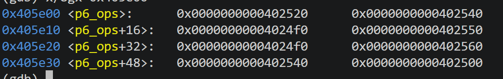

通过disassemble,解析出每个函数里面的内容，此处只解析出来第一个作为示例：

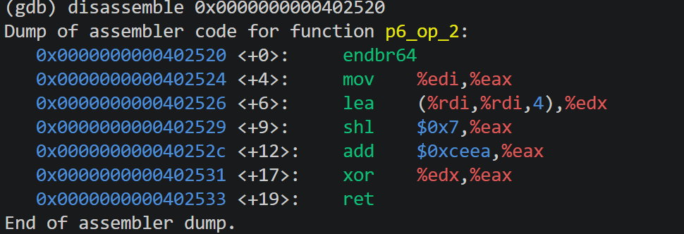

读取0x405e00的八个指针，操作编号依次是2、3、0、4、0、5、3、1。重复项是实际表内容。

| 操作 | 32位计算 |
| --- | --- |
| op0 | (x + 0xa7ef) ^ (x >> 7) |
| op1 | ((x >> 3) ^ x) + 0xfc29 |
| op2 | ((x << 7) + 0xceea) ^ (5*x) |
| op3 | ROL32(x,1) ^ 0xeb2b |
| op4 | ROR32(x,7) |
| op5 | (x ^ 0x6b5c) + (x << 5) |

ROL32(x,1)=U32(x<<1)|(x>>31)，ROR32(x,7)=(x>>7)|U32(x<<25)，不是普通移位。完整关系：

```c
argument = U32(C >> 6) ^ U32(C >> 32);
i = U32(C & 7u);
j = U32((C >> 3) & 7u);
result = ops[i](argument);
result ^= 0x1215u;
result = ops[j](result);
answer = result + 0x776du;
```

第二次调用的C&0x38是字节偏移，等于((C>>3)&7)*8，所以对应下标j。解法保留函数指针数组，输出一个整数。如第一次。

## 4. Honor：相邻字段覆盖与联合校验

### 4.1 context来源

项目defuser_main.c的--secret分支先在内存生成六行答案，再调用transcript_context(lines)，将context和第7关challenge传入solve_secret。不过这部分生成过程不用在solve_secret里面重写。从函数输入的角度，可以把它理解为多给了一个challenge2；但context不是另一个独立随机数，它依赖前六关的答案。

challenge.c中context初始为0x243f6a8885a308d3，按phase1～6处理，每关先混入编号，再解析该行十进制整数，逐项混入数值、关卡编号、从0开始的字段编号：

```c
context = context_mix(context ^ phase);
context = context_mix(context ^ value
                      ^ (((uint64_t)phase << 32) | field));
```

context_mix用右移异或和两个64位乘法常量混合。context来自前六关数字及其顺序，不是隐藏关内部另外生成的随机数。

### 4.2 gate与输入布局

```asm
lea    -0xd0(%rbp),%r12
call   secret_copy
cmpl   $0x4e45504f,-0xb0(%rbp)
jne    失败路径
lea    -0xac(%rbp),%rdi
call   secret_phase
```

复制起点为rbp-0xd0，被检查字段偏移32，后缀起点偏移36。secret_copy逐字节复制至NUL，越过前面字符区域并影响相邻字段。小端序下字节4f 50 45 4e，即OPEN，被读为整数0x4e45504f。构造格式为：

```text
[32字节填充][OPEN][整数一 整数二 整数三]
```

strlen(input)-36<=127使用无符号比较，允许总长度36～163字节。secret_phase用%u %u %u解析后缀。这里影响的是相邻数据字段，不覆盖返回地址，不需要shellcode；恢复的是偏移关系，不是原作者成员名。

### 4.3 三个数的计算

记context为K：

```c
s = U32(K & 3u);
A = U32(C >> 32) ^ U32(C);
B = U32(K >> 32) ^ U32(K);
D = (0xfd6eu * s) ^ U32(K >> 16);
x = A ^ B;
```

secret_mix关键指令：

```asm
mov    %edi,%eax
xor    $0xfd6e,%edi
shr    $0x3,%eax
xor    $0x254b,%eax
add    %edi,%eax
```

得到M=((x>>3)^0x254b)+(x^0xfd6e)。检查函数确认esi、r8、rcx、r9未被改写，调用者仍能使用A、B、s、D。三个数为：

```c
first  = s;
second = M ^ D;
third  = second ^ (B + s + 0x254bu + (A >> 3));
```

用snprintf一次写入32个A、OPEN和三个数，不添加换行。返回值为负或大于等于cap时失败。first最大为3，其余两数最多各10位，整行最多60字符，符合长度限制；仍检查缓冲区容量。
备注：本关与前几关的区别，除了多了context以外，这里没有直接使用write_answer辅助，而是用snprintf把三个值拼成符合要求的字符串（前面是32个填充字符，中间四个是大写OPEN，后面是三个答案）。新知识不只是输入格式要求更复杂，还要理解secret_copy怎么把输入复制到相邻字段、为什么要在偏移32处写OPEN，以及小端序如何让这四个字符通过secret_gate的整数比较。

最终六关考察原理总结：

 disassemble 解析出的机器指令，它的原函数是输入input 以及challenge两个值，通过challenge计算出一个或多个结果，与input里面的值进行比较。而我们的任务则是构造input：通过challenge求出值，将这些数格式化写进out，驱动再输出给bomb读取。

## 5. 验证记录与截图

### 5.1 完成情况和测试范围

正式六关与Honor均已通过。各关公开测试均为10/10；另外，第1～6关都使用公开列表以外的seed43验证，实际截图如下。Honor的完整运行截图显示了Secret成功信息；该图没有显示命令和seed，所以不单凭这张图断言它使用seed43。第5.5节的441个seed扩展测试包含43，并逐个检查六关及Honor，提供了Honor的非公开seed验证记录。

当前`tests/public.json`的公开seed为：

```text
0, 1, 7, 42, 99, 123, 2026, 65535, 987654321, 18446744073709551615
```

43不在其中，可用于每关额外验证。

### 5.2 第1关记录

| 测试 | 实际记录 |
| --- | --- |
| seed42 | `Phase 1 defused.`，challenge为`0x28efe333b266f103` |
| 公开测试 | `Public tests: 10/10` |
| 非公开seed43 | `Phase 1 defused.`，challenge为`0x9cde98852e60034b` |

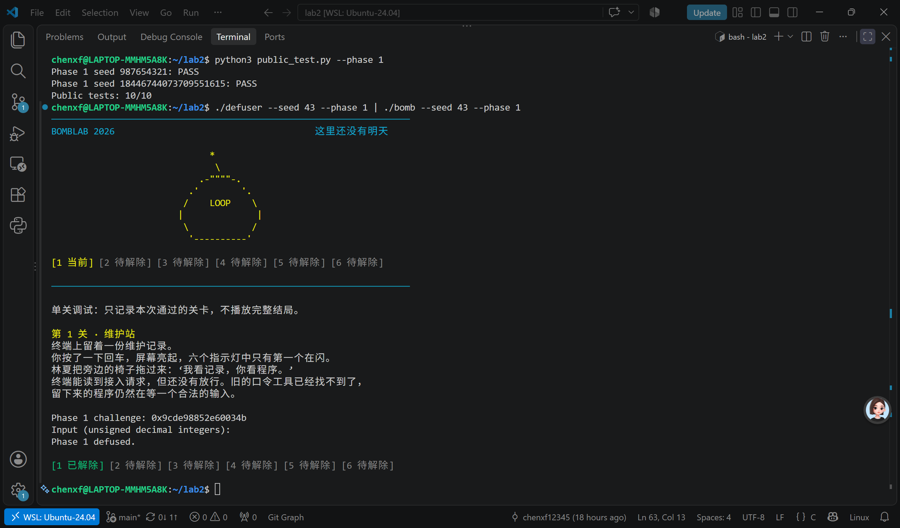

### 5.3 第2～6关记录

每关的单独验证命令使用相同的seed和phase，例如第2关：

```bash
./defuser --seed 43 --phase 2 | ./bomb --seed 43 --phase 2
python3 public_test.py --phase 2
```

其余关卡替换phase编号。下表中的challenge和成功信息来自对应截图；公开测试各关分别10/10，合计60项通过，不将这一合计描述成额外运行过的汇总命令。

| 关卡 | 非公开seed | challenge | 单关结果 | 公开测试 |
| --- | --- | --- | --- | --- |
| 第2关 | 43 | `0x6ec624aa85685867` | `Phase 2 defused.` | 10/10 |
| 第3关 | 43 | `0xd49ffe504bfdab7f` | `Phase 3 defused.` | 10/10 |
| 第4关 | 43 | `0x006ff81b72d591ff` | `Phase 4 defused.` | 10/10 |
| 第5关 | 43 | `0x18e47d0995aecbfe` | `Phase 5 defused.` | 10/10 |
| 第6关 | 43 | `0x523fb4dd5d162e88` | `Phase 6 defused.` | 10/10 |

#### 第2关

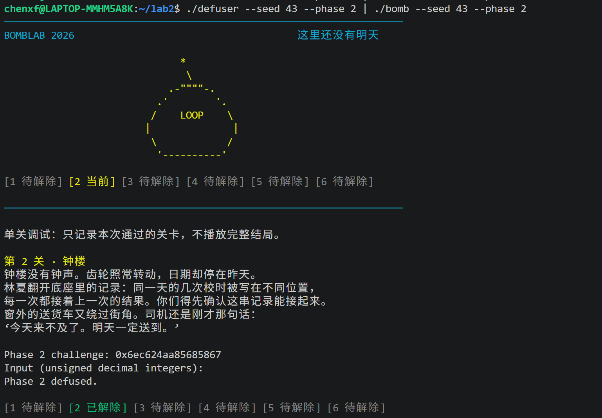

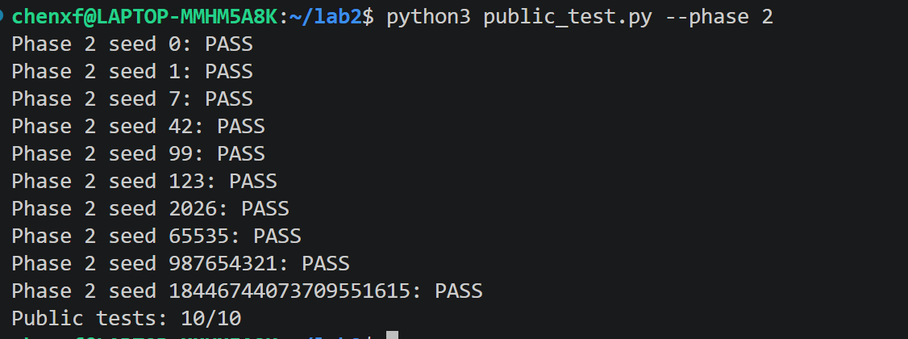

#### 第3关

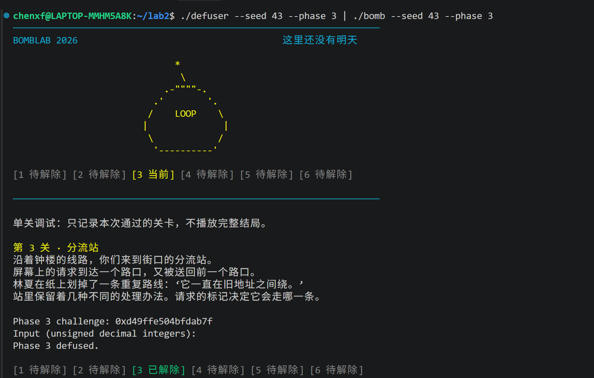

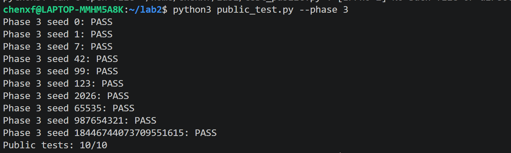

#### 第4关

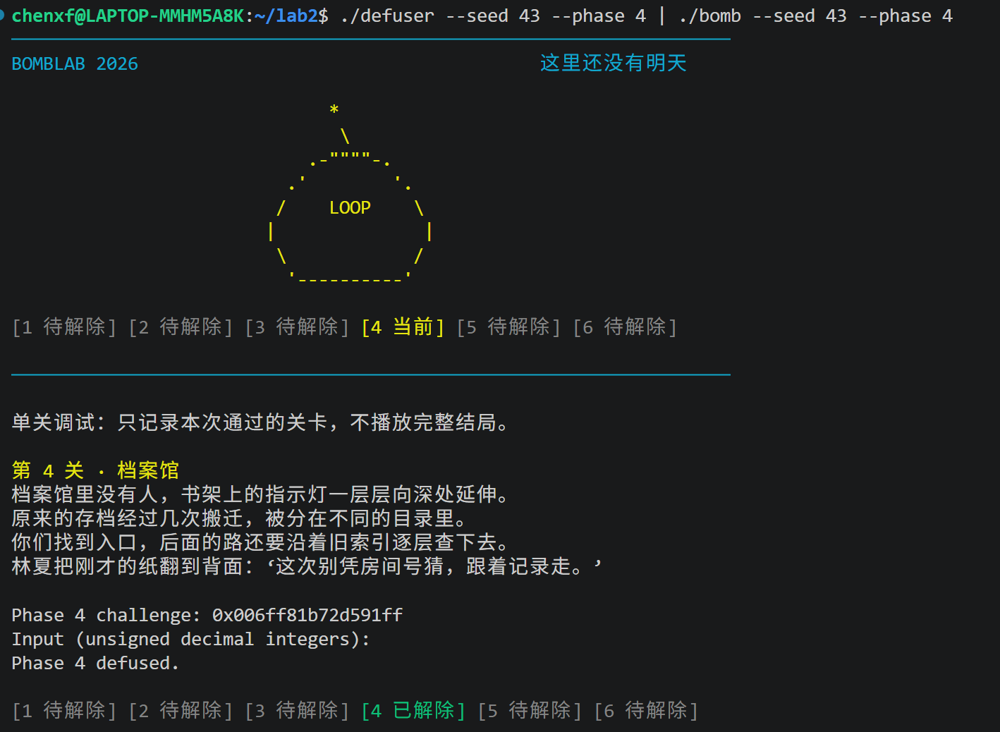

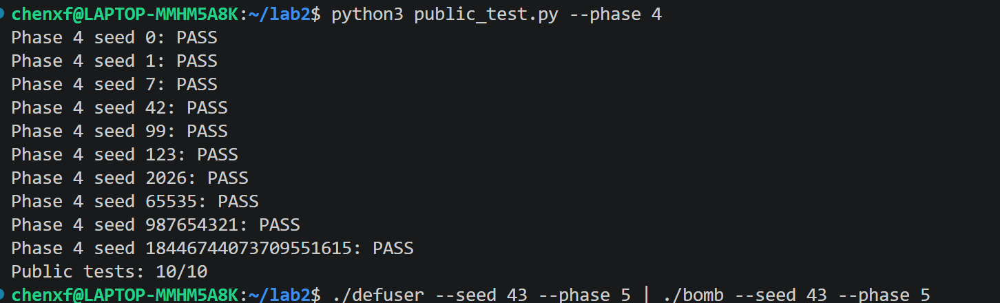

#### 第5关

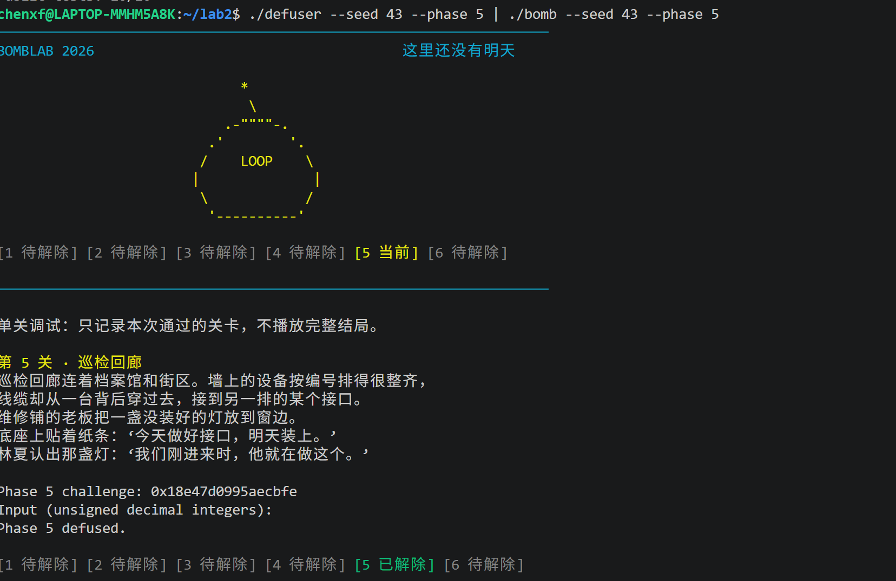

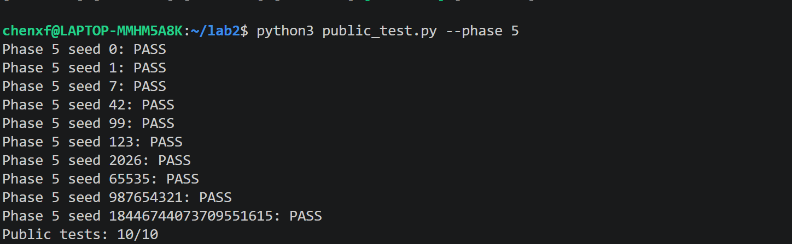

#### 第6关

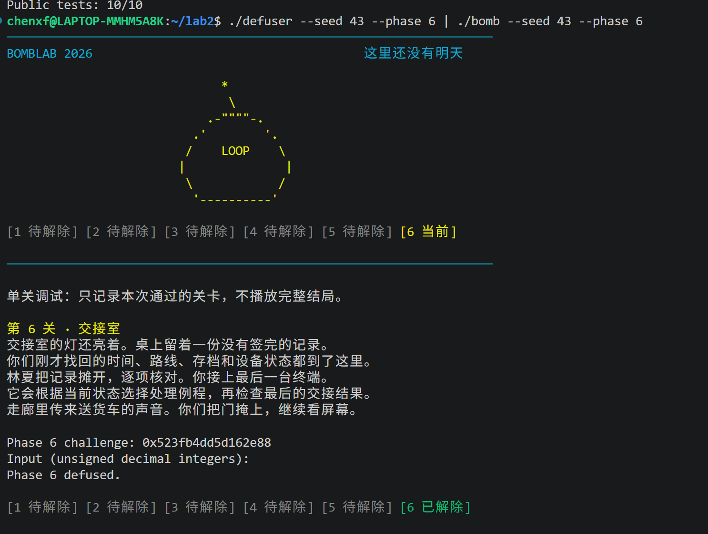

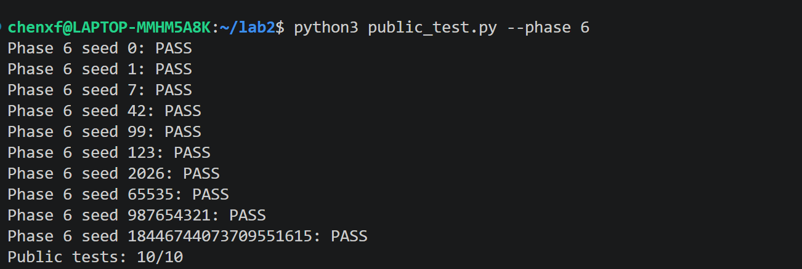

### 5.4 Honor记录

Honor公开测试的实际命令为：

```bash
python3 public_test.py --secret
```

截图显示10个公开seed全部PASS，汇总为`Secret public tests: 10/10`。完整运行截图还显示前六关全部解除及`Secret phase defused.`。该完整运行截图没有包含seed，非公开seed43的依据另见下一节扩展测试。

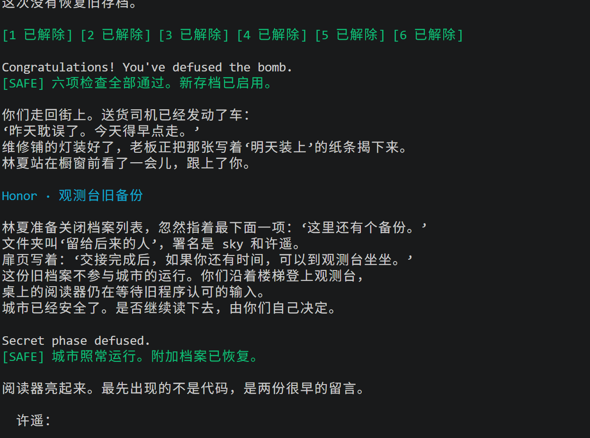

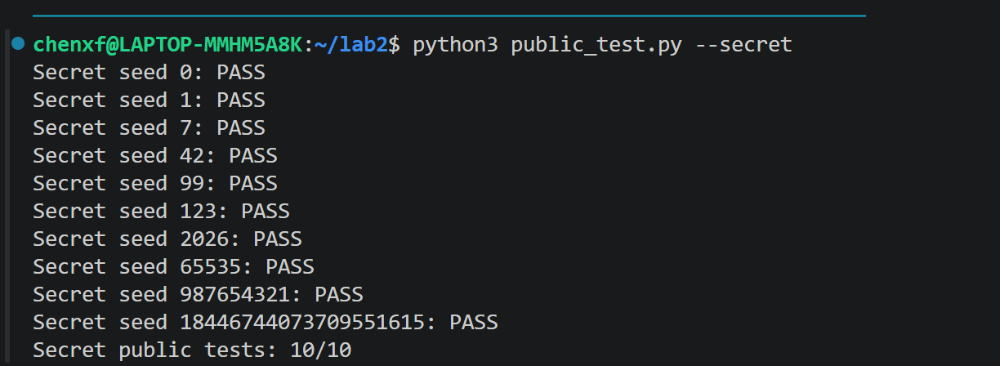

### 5.5 扩展测试

实际执行：

```bash
make && python3 test.py
```

脚本默认添加200个随机seed，并使用随机生成器seed`20261024`。固定测试包含0～63、2的各次幂及相邻值、最大64位无符号数、交替位模式等，去重后共241个；加上200个不同的随机seed，总计441个。截图实际显示：

```text
Testing 441 seeds: six phases + Honor
Random generator seed: 20261024
PASS 441/441
All tested seeds passed all six phases and Honor.
```

脚本对每个seed运行六关求解器和Honor求解器，再将完整七行输入交给bomb，检查退出状态、各关成功标记、行数及超时。检查脚本可知固定列表包含`range(64)`，因此43确实在本次通过的441个seed内，Honor的非公开seed验证也被覆盖。这不是把随机生成器seed误当作炸弹seed。

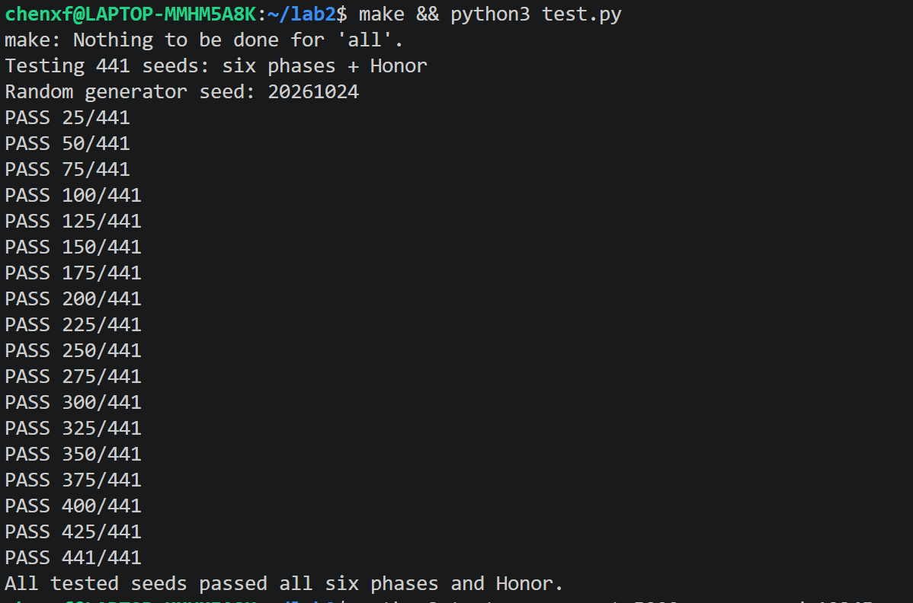

本次记录是441个seed，并未据此声称执行过5000个随机seed。seed经驱动混合才生成challenge，不能仅凭seed低位覆盖断言所有分支已覆盖。随机测试增加可信度，但不能替代运算宽度、区间边界、表映射及数据布局的分析，也不等同于隐藏测试满分。

## 6. 调试问题与处理

### 6.1 重定向错误

第2关调试曾把run ... < phase2-input.txt误写成run ... > phase2-input.txt。前者读取口令，后者将炸弹输出写入文件并覆盖原内容。等待口令时输入的p/x $r13被当作口令，而非GDB命令。

恢复时重新生成输入文件，设置断点并用<启动；确认出现(gdb)提示符后才输入调试命令。这是操作问题，不能据此判断计算公式错误。

### 6.2 编译失败和旧程序

第4关曾出现Phase 4 solver is incomplete or failed，随后make报：

```text
error: control reaches end of non-void function [-Werror=return-type]
```

递归函数用三个独立if处理相等、小于、大于，编译器没有确认返回路径完整。相等和小于分支提前返回后，直接执行剩余右分支，使返回路径明确。源码更新不自动更新可执行文件，不能在编译失败后继续用旧defuser判断新实现。之后采用make && ./defuser ...，先确认编译成功。管道左侧失败导致无口令时，炸弹也会失败，应先区分求解器错误与错误答案。

### 6.3 输出格式

正式关卡用write_answer生成空格分隔的无符号十进制整数，不在out中写换行。snprintf返回完整输出本应需要的字符数，不包括NUL，必须检查是否大于等于剩余容量。Honor也检查截断，并单独构造前缀。调试信息不混入标准输出。

## 7. 实验收获与局限

本实验建立了机器操作与程序语义的对应：寄存器不是固定变量名，lea可用于整数计算，比较和跳转形成控制流，递归返回仍会继续运算，指针表要读取真实数据，结构体通过偏移和访问宽度识别。

求解器恢复约束并生成满足约束的字符串。Honor额外要求解释复制、偏移和小端序，不只是记住OPEN。本文常量与数据属于个人炸弹，不适用于其他同学。现有公开测试、非公开seed43和441个seed的扩展验证，仍不能保证所有隐藏输入都正确。

## 8. 参考资料与辅助工具说明

1. 课程《Lab2：BombLab》实验说明及提供的PDF，用于实验流程、调试、Honor入口和提交要求：[实验页面](https://ics-26fall-fdu.github.io/labs/lab2-bomb-lab/)。
2. 课程《Coding Agent入门》，用于了解项目约定和AI辅助流程：[材料页面](https://ics-26fall-fdu.github.io/misc/coding-agent/)。
3. 项目README.md、AGENTS.md、tests/public.json、challenge.c、defuser_main.c及tutor教学材料，用于接口、辅助约定、测试范围、context来源和练习。
4. GDB、objdump、GCC、GNU Make、Python，用于反汇编、调试、编译和验证。
5. OpenAI Codex：解释汇编、调用约定、C语法和GDB；核对手稿及还原代码；协助整理并生成各关求解实现和Honor构造；定位编译与重定向错误；编写扩展测试脚本；整理本报告。部分实现由工具根据交互中的汇编和分析生成，并非全部独立手写。本人负责理解、审查及在个人炸弹上验证，不将工具提供的分析包装成未经辅助的独立成果。使用范围以课程公告和助教要求为准。


首次提交示例（核对文件后自行执行）：

```bash
git add -f bomb
git add defuser.c report.md images/
git commit -m "submit lab2"
git tag final
git push
git push origin final
```

若final已存在，按实验文档更新标签，不重复首次创建命令。辅助脚本和临时日志不要求提交；不要提交defuser可执行文件、整份反汇编和调试日志。
